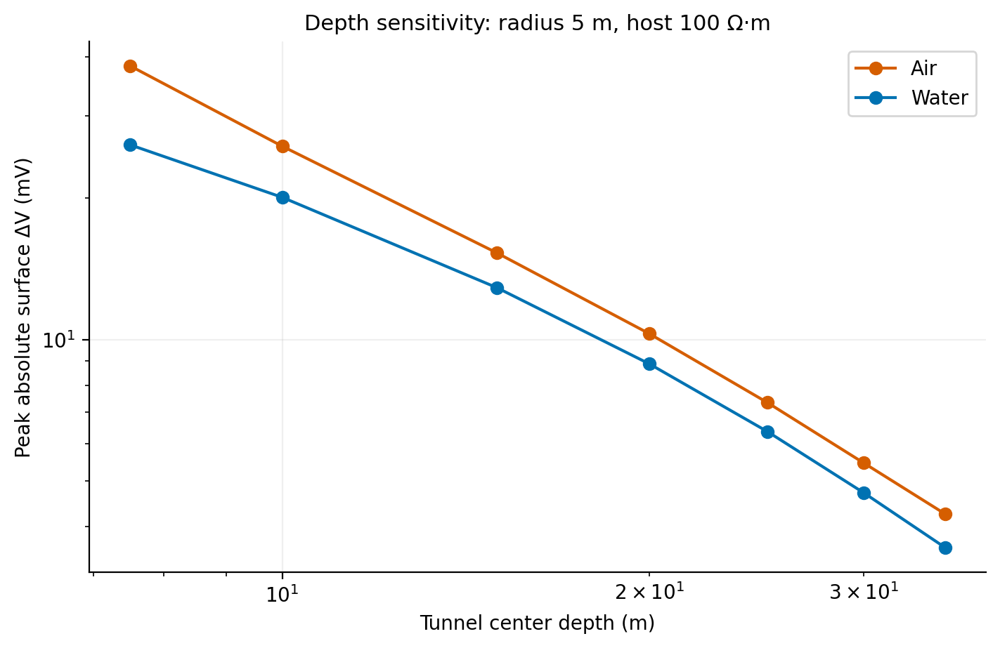
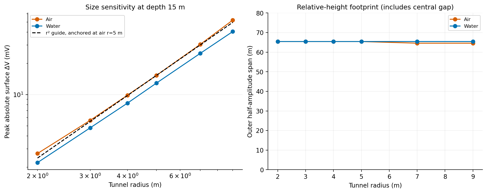
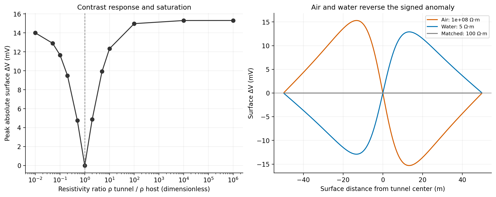
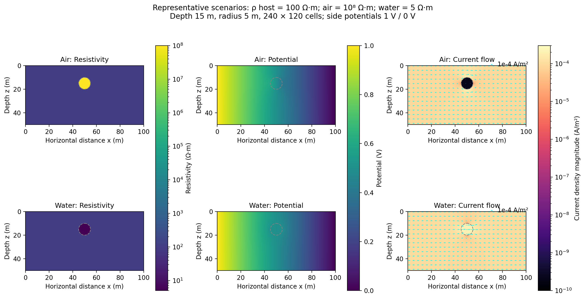
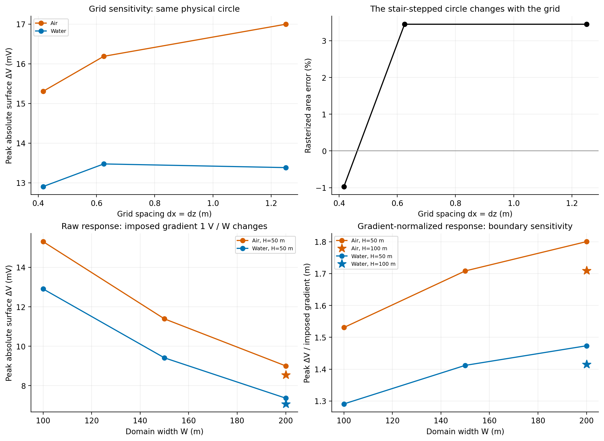

# Step 5 — Geophysical analysis and interpretation

**Model scope:** these experiments use the retained fixed-voltage 2D solver
and `legacy_app.py`, not the default point-electrode survey model. Their voltage
anomalies are not apparent resistivity. For the current survey pipeline see
[the verification guide](../docs/VERIFICATION_2P5D.md),
[survey examples](../docs/SURVEYS.md) and [current review](../FINAL_REVIEW.md).

## Question and reproducibility

How do tunnel depth, size, and electrical contrast change the predicted potential
near the ground surface? The historic **Onyx mine in Steamboat Springs, Colorado**
motivates this question. These experiments use hypothetical properties and no
Onyx survey data; they are not calibrated predictions for that mine.

From the repository root, using the existing scientific-Python environment:

```bash
source .venv/bin/activate
MPLBACKEND=Agg MPLCONFIGDIR=/tmp/tunnel-mpl XDG_CACHE_HOME=/tmp/tunnel-cache \
  python -m analysis.run_experiments
python -m unittest discover -s tests -v
```

The script calls the existing `circular_tunnel`, `solve_conductivity`, and
`solve_homogeneous` functions. It adds no PDE solver or UI features. Repeated
models/references are reused within each run, without a persistent cache that
could become stale. The completed run produced **53 experiment records from
45 distinct tunnel solves and 7 homogeneous solves**. At that original analysis milestone, **42 tests passed**,
including the previous 39 and three new analysis checks. No solver errors were
found or method changes needed. The production modules and executed
`verification.ipynb` are unchanged, checked by pre/post hashes.

## Model, controls, and measures

Unless varied below: width 100 m, height 50 m, 240×120 cells, dx=dz=0.416667 m,
center x=50 m, center depth 15 m, radius 5 m, host resistivity 100 Ω·m.
Every solve uses **left 1 V, right 0 V, insulated top and bottom**. Air is
approximated by finite resistivity 1e8 Ω·m (conductivity 1e-8 S/m); the conductive
water scenario is 5 Ω·m (0.2 S/m). These labels are illustrative, not measured
properties of mine air, rock, or water. All conductivities remain positive/finite.

Define `ΔV(x) = V_tunnel(x, top) − V_homogeneous(x, top)` and
`A = max(abs(ΔV))`. The top value uses the first cell row with the insulating
zero-gradient reconstruction, as in the app. The first-row center is at depth
0.208333 m on the primary grid; it is not an electrode measurement. Every case
uses a matching homogeneous reference on the **same grid and boundaries**.

Each summary row records all dimensions, grid counts, geometry, resistivities,
boundary values, spacing, sampling depth, signed peaks/locations, amplitude,
total current/reference/current change, rasterized area, and numerical checks.
Signed peak positions are offsets from the tunnel center. An absolute-peak tie
uses the leftmost maximum within relative 1e-10, avoiding arbitrary roundoff
choices between symmetric lobes. Matched material has no meaningful peak location.

To describe spatial extent, the **outer half-amplitude span** is the distance
between the outermost samples with `abs(ΔV) >= A/2`. It includes the central zero
gap of the two-lobed signal: it is neither a single-lobe FWHM nor an instrument
detection width. A fixed absolute threshold would answer a different question.

### Exact sweeps

| Experiment | Varied parameters | Held fixed |
| --- | --- | --- |
| A: depth | 7.5, 10, 15, 20, 25, 30, 35 m; air and water | Radius 5 m, properties, dimensions and grid |
| B: radius | 2, 3, 4, 5, 7, 9 m; air and water | Depth 15 m, properties, dimensions and grid |
| C: contrast | ρ tunnel / ρ host = 0.01, 0.05, 0.1, 0.2, 0.5, 1, 2, 5, 10, 100, 1e4, 1e6 | Geometry, host 100 Ω·m, dimensions and grid |
| D: grid | 80×40, 160×80, 240×120; air and water | Geometry, properties and 100×50 m domain |
| D: side boundaries | Width 100, 150, 200 m; nx 240, 360, 480; air and water | Height 50 m, nz 120, spacing, depth/radius/properties; center at W/2 |
| D: bottom boundary | Height 50 versus 100 m at width 200 m | dx=dz=0.416667 m, nx=480, nz=120 versus 240, same tunnel |
| Host-scaling control | Host/tunnel 100/5 versus 200/10 Ω·m | Geometry, grid, dimensions, voltage boundaries and contrast |

Depth translations are aligned with the grid so the rasterized circle's area
remains exactly 77.777778 m² throughout A, avoiding an area-change confound.

## A — Depth: weaker and broader for the tested deeper tunnels

| Depth (m) | Air A (mV) | Water A (mV) |
| ---: | ---: | ---: |
| 7.5 | 38.309 | 26.008 |
| 10 | 25.825 | 20.099 |
| 15 | 15.308 | 12.907 |
| 20 | 10.304 | 8.887 |
| 25 | 7.350 | 6.377 |
| 30 | 5.463 | 4.720 |
| 35 | 4.252 | 3.606 |

Across 7.5–35 m the peak decreases **88.90% (air)** and **86.14% (water)**.
Descriptive log-log fits give `A ∝ depth^-1.414` and `depth^-1.280`, respectively.
These are fits over this finite rectangle and parameter range, not universal
attenuation laws. Depth doubling from 15 to 30 m reduces the air peak by a
factor of about 2.80. Geometrically, a deeper perturbation is farther from the
surface and spreads over a wider region; side/bottom boundary interactions also
influence the decay rate.

The outer half-amplitude span grows from 44.58 to 79.58 m for air and 46.25 to
79.58 m for water. Signed peak offsets move from roughly ±7 m to ±21.9 m.
This broadening is measured here; it does not imply a corresponding field
instrument detection footprint.



## B — Radius: stronger, approximately quadratic, but not necessarily wider

At depth 15 m, increasing radius from 2 to 9 m raises A from **2.710 to 52.147 mV**
for air and **2.214 to 40.445 mV** for water: factors of **19.24** and **18.27**.
Log-log fits over all six radii give exponents **1.967** and **1.936**, with
log-space R² of 0.99905 and 0.99994. The relationship is nonlinear and roughly
quadratic in this range, consistent with the growing cross-sectional area and
the strength of the current-flow perturbation. This empirical fit is not a
verified analytical law for the finite-domain tunnel.

An important exception to a simple expectation: the **relative-height span does
not increase** with radius. It stays about 65.42 m for water and changes from
65.42 to 64.58 m for air (−1.27%). At a fixed burial depth, the far-surface pattern
scale is largely controlled by depth/domain geometry while size mainly changes
amplitude. A width defined using a fixed voltage threshold could behave differently.



## C — Resistivity contrast: sign reversal, no anomaly at a match, saturation

For depth 15 m and radius 5 m:

| Tunnel resistivity (Ω·m) | Ratio to host | A (mV) | Total-current change from reference |
| ---: | ---: | ---: | ---: |
| 1 | 0.01 | 13.999 | +3.028% |
| 5 (water) | 0.05 | 12.907 | +2.791% |
| 50 | 0.5 | 4.765 | +1.029% |
| 100 (matched) | 1 | 0 | 0% |
| 200 | 2 | 4.872 | −1.051% |
| 10,000 | 100 | 14.977 | −3.226% |
| 1,000,000 | 1e4 | 15.304 | −3.296% |
| 100,000,000 (air proxy) | 1e6 | 15.308 | −3.297% |

At the representative geometry, air is positive to the left and negative to the
right; water reverses this signed pattern. Peaks are approximately 13.125 m to
either side of the center. The matched case is identically the homogeneous model.
Reciprocal contrasts do not give exactly equal magnitudes in these computed
finite-domain, stair-stepped models; no exact reciprocal-magnitude symmetry was
assumed. Increasing the resistive contrast from 1e4 to 1e6 changes A by only
**0.02166%**, demonstrating saturation in this run, not unlimited growth.
That increment is much smaller than the measured grid/domain sensitivity, so it
supports a qualitative saturation interpretation, not precise estimation of an
air-filled tunnel's resistivity.

Resistive material carries little current, forcing flow around it and altering
the surrounding potential gradient. Conductive material accepts more current
and redistributes the gradient; the potential is flatter inside it. Mean interior
current-density magnitudes are **2.13e-10 A/m² (air)** and **1.89e-4 A/m² (water)**,
against a uniform-host value of 1e-4 A/m². Total currents are 0.00483515 and
0.00513956 A/m per unit thickness, versus reference 0.005 A/m.





### Host-rock properties and nonuniqueness

Changing host resistivity with fixed tunnel resistivity changes both the
conductivity contrast and current throughput. Changing all resistivities by a
common factor is different: a uniform multiplier on conductivity cancels from
the fixed-voltage PDE. Doubling host/tunnel resistivities from 100/5 to 200/10 Ω·m
gave **zero potential-field difference in this computation and exactly half the
current**. Absolute resistivity scale is therefore not recoverable from these
potential fields alone under this excitation.

Geometry also trades off with material contrast. For example, an air tunnel with
radius 3 m at depth 15 m gives A=5.647 mV, while radius 5 m at depth 30 m gives
5.463 mV, within about 3.4% despite different geometry. Their spatial profiles
can differ; a similar peak alone does not imply identical complete data. Combined
with unknown geology, boundary effects, and noise, potential anomalies do not
uniquely specify tunnel geometry and material properties. No inversion is performed.

## D — Resolution and domain sensitivity

| Grid | Rasterized area (m²) | Air A (mV) | Water A (mV) |
| --- | ---: | ---: | ---: |
| 80×40 | 81.250 | 16.999 | 13.385 |
| 160×80 | 81.250 | 16.190 | 13.478 |
| 240×120 | 77.778 | 15.308 | 12.907 |

The geometric circle area is 78.540 m². Coarse/medium area errors are +3.45%; fine
area error is −0.97%. Medium-to-fine A changes are **−5.45% (air)** and **−4.23%
(water)**. Total currents change much less: +0.204% and −0.117%, respectively.
The water peak changes nonmonotonically. Inspection shows that sampling the circle
at cell centers changes its stair-stepped perimeter and sometimes its area;
even equal areas do not imply equal interface resistance. First-row surface
sampling depth also changes with grid spacing. This is a sensitivity check, not
a claim that the fine grid is exact or that the circular-interface scheme is
second order. The smooth-case verification notebook remains a separate result.

### Side boundaries: account for the changed applied field

With fixed side voltages, increasing width W reduces the homogeneous gradient
`E0 = (1 V)/W`. A raw voltage comparison therefore mixes weaker forcing with
boundary displacement. We also compare **A/E0**, in meters. Linearity of the PDE
in voltage makes this an equal-gradient response comparison; it is **not apparent
resistivity**. Mesh spacing and the rasterized tunnel stay fixed in this test.

| W (m), H=50 m | Air A (mV) | Water A (mV) | Air A/E0 (m) | Water A/E0 (m) |
| ---: | ---: | ---: | ---: | ---: |
| 100 | 15.308 | 12.907 | 1.53076 | 1.29071 |
| 150 | 11.390 | 9.412 | 1.70843 | 1.41183 |
| 200 | 9.003 | 7.367 | 1.80054 | 1.47340 |

The gradient-normalized peak increases **17.62% (air)** and **14.15% (water)** from
W=100 to 200 m. Thus artificial side boundaries materially affect these results.
Changes from W=150 to 200 m are still 5.39% and 4.36%; domain independence has
not been established. At W=200 m, moving the bottom from 50 to 100 m reduces A
another **5.08% (air)** and **3.98% (water)**. The bottom boundary matters too.
This limited experiment distinguishes forcing from boundary effects but is not
a full open-domain convergence study.



## Numerical checks and stored evidence

Every record passed positive/finite conductivity, bounded potential, residual,
and local/global conservation checks. Across the complete run, maximum residual
was **1.11e-15 A/m**, maximum relative boundary-current imbalance **5.41e-12**,
and maximum cell imbalance / maximum face current **1.10e-11**. Small residuals
and conservation are necessary checks, not estimates of geometric error.

Files in `analysis/results/` are deliberately **not ignored by Git**:

- `summary.csv`: 53 rows with exact parameters, peak signs/locations, area,
  current comparisons and diagnostics. Units are included in column names.
- `surface_profiles.csv`: each scenario's surface samples, x coordinates and
  center-relative offsets, allowing the signed patterns to be replotted.
- `trend_statistics.csv`: descriptive fits and percentage changes quoted here.
- `provenance.json`: numerical-library versions, production-solver hash, solve
  counts, and definitions of the surface sample, extent, and normalization.
- Five figures, each saved as a GitHub-readable PNG and a presentation/export PDF.
  Map cells are rasterized inside the PDFs, with vector axes/text.

The executed `verification.ipynb` is unchanged and is staged explicitly for Git
alongside these analysis artifacts. Staging makes the files part of the next
normal commit; it does not itself commit or upload them. The rest of the project
also needs to be committed and pushed for a complete GitHub submission.

## Field relevance and presentation

This model helps explain why a void's electrical response depends on burial,
cross-sectional area, and contrast, and why changing current paths creates signed
surface-potential anomalies. It can guide questions for interpreting a mine survey,
but does **not** prove whether an Onyx tunnel is detectable by a particular instrument:

- Fixed-potential side boundaries are idealized, not an ERT current-electrode array.
- The circular section represents a tunnel infinitely long perpendicular to the
  model plane, not a finite, irregular mine passage.
- Homogeneous isotropic host and constant tunnel properties omit real geology,
  groundwater variability, topography, contact resistance, and other structures.
- Rectangular-grid stair steps and large contrasts affect numerical accuracy.
- Surface ΔV is not a measured apparent-resistivity anomaly. Electrode spacing,
  injected current, noise, instrument sensitivity and actual site properties
  were not supplied or modeled. No detection threshold or field validation is claimed.

For the short final presentation, use **01_depth**, **02_radius**, and
**03_contrast_and_profiles** for the main scientific question. Use the app or
**04_representative_maps** to explain current diversion/concentration. Keep
**05_grid_domain_sensitivity** as the limitations slide or backup: its key message
is that a verified solver can still give boundary- and mesh-dependent tunnel signals.
The required analytical verification walkthrough should still use the separate,
executed `verification.ipynb`.

Source of the Onyx motivation: the student's stated field investigation. Numerical
values above are outputs of this project, not literature or measured mine values.
See the repository's `AI_USE.md` for assistance disclosure.
